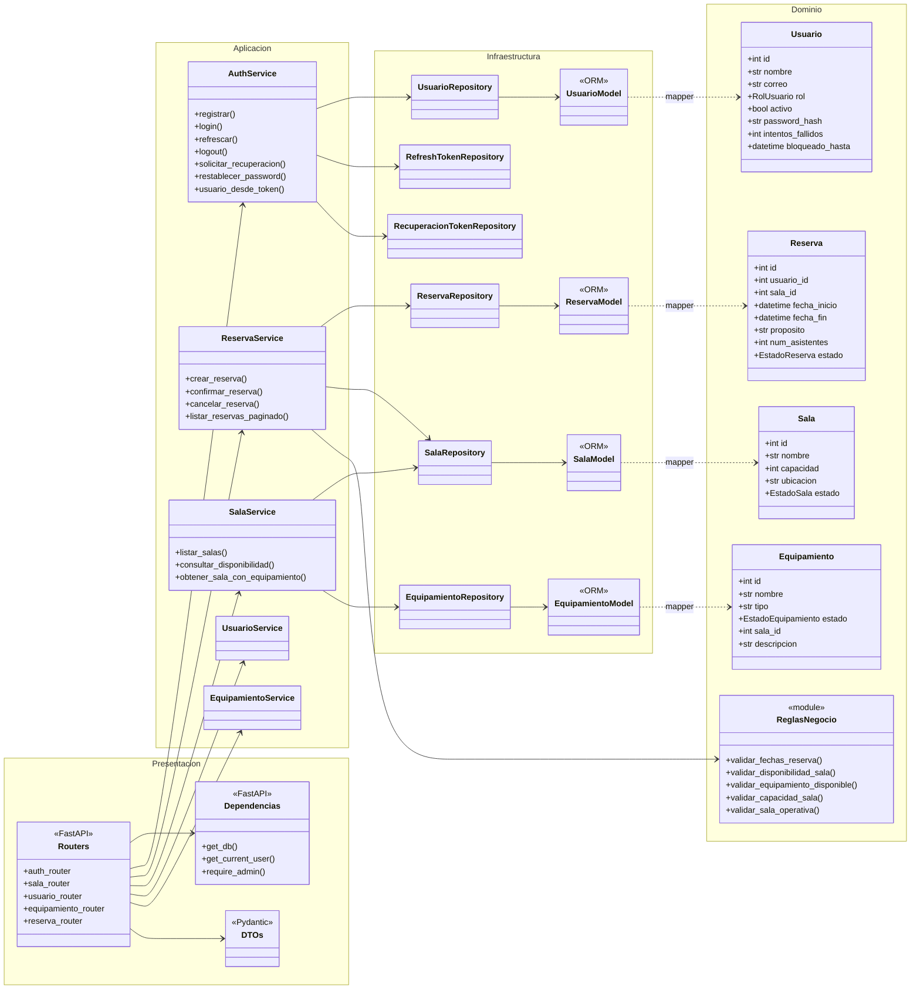

# Diagrama de clases

Arquitectura por capas: **presentación → aplicación → dominio ← infraestructura**.
El dominio no importa FastAPI ni SQLAlchemy; la infraestructura implementa la
persistencia y los mappers traducen entre entidades y modelos ORM.



## Flujo de una petición

```
Cliente HTTP
   │  JSON + Bearer token
   ▼
Router (presentación)  ── valida DTO, aplica dependencias (401/403)
   │
   ▼
Service (aplicación)   ── casos de uso y transacciones
   │
   ▼
Reglas de negocio (dominio)  ── reglas puras, sin framework
   │
   ▼
Repository (infraestructura) ── consultas SQLAlchemy
   │
   ▼
Modelo ORM ──► Base de datos (SQLite / PostgreSQL)
```

## Dependencias entre capas

| Capa | Puede importar | No puede importar |
|---|---|---|
| Dominio | Solo biblioteca estándar | FastAPI, SQLAlchemy, Pydantic |
| Aplicación | Dominio, repositorios, DTOs | Routers |
| Infraestructura | Dominio, SQLAlchemy | Routers |
| Presentación | Aplicación, dominio, DTOs | SQLAlchemy directo (usa repositorios) |
