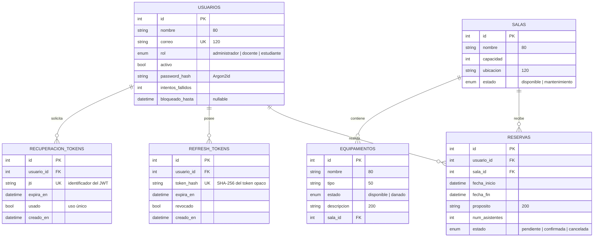

# Diagrama de datos

Modelo relacional implementado con SQLAlchemy y versionado con Alembic.
Cuatro entidades de negocio (`usuarios`, `salas`, `equipamientos`, `reservas`)
más dos tablas de seguridad (`refresh_tokens`, `recuperacion_tokens`).



## Relaciones y cardinalidad

| Relación | Cardinalidad | Regla de integridad |
|---|---|---|
| Usuario → Reserva | 1:N | No se puede eliminar un usuario con reservas (FK). |
| Sala → Reserva | 1:N | Una sala con reservas no se elimina: responde `409`. |
| Sala → Equipamiento | 1:N | El equipamiento requiere una sala existente (`404` si no existe). |
| Usuario → RefreshToken | 1:N | Se eliminan en cascada con el usuario. |
| Usuario → RecuperacionToken | 1:N | Se eliminan en cascada con el usuario. |

## Índices y restricciones

- `usuarios.correo` es **único** (regla de negocio y restricción de base).
- `refresh_tokens.token_hash` es **único**; nunca se guarda el token en claro.
- `recuperacion_tokens.jti` es **único** y `usado` garantiza el uso único.
- Claves foráneas con `ON DELETE CASCADE` en las tablas de seguridad.
- En SQLite se activa `PRAGMA foreign_keys=ON` en cada conexión.

## Migraciones

| Revisión | Descripción |
|---|---|
| `e4571a0ef542` | Crea las tablas iniciales (`usuarios`, `salas`, `equipamientos`, `reservas`). |
| `a1b2c3d4e5f6` | Agrega credenciales, `refresh_tokens` y `recuperacion_tokens`. |

```bash
alembic upgrade head     # aplica las migraciones
alembic downgrade -1     # revierte la última
python -m app.infrastructure.seeders.seed   # datos de demostración
```
